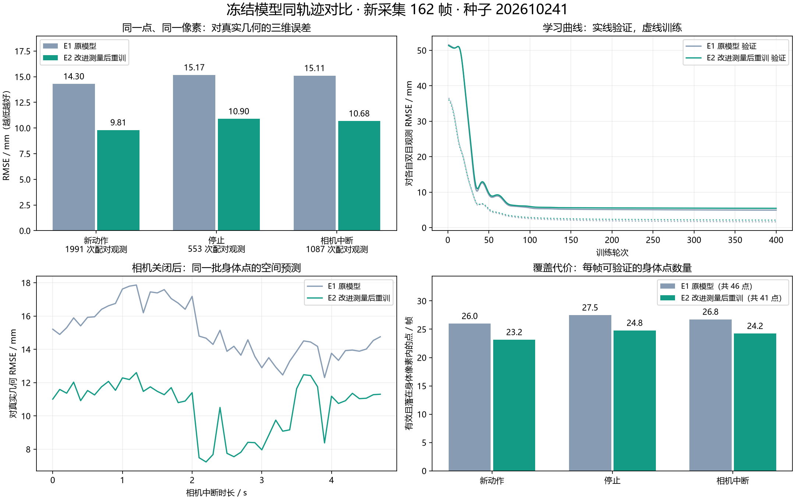
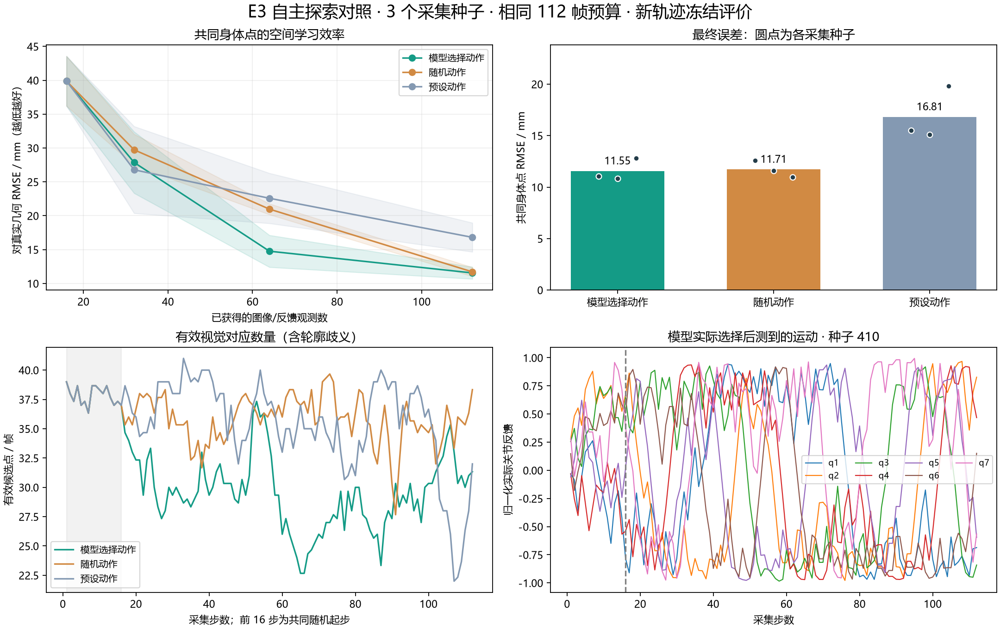
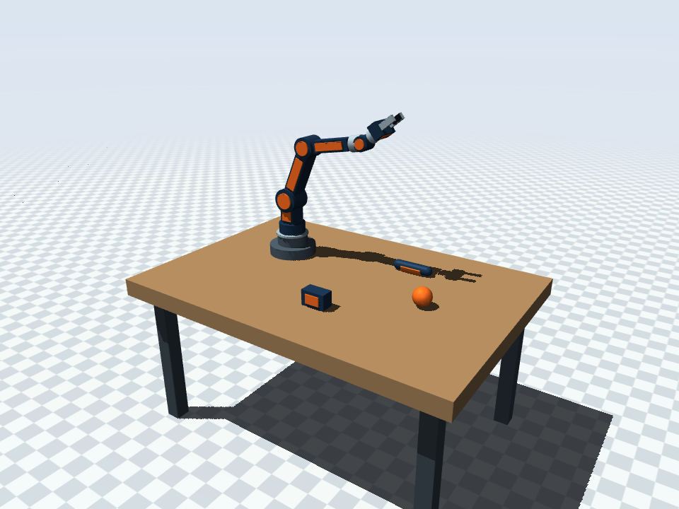

# ArmSelf-perception

让模型通过自身运动，将**动作命令、实际反馈和视觉证据**连接到同一个持续身体表示：发现自己的活动身体，估计并预测它的状态，表示它占据的空间，并在证据不足或冲突时表达不确定性、利用后续证据纠错。

**当前研究依据：[课题定义、三个核心问题与可靠感知验收框架](docs/research-definition.md) · [目标与边界简表](docs/research-scope.md)**

三个核心问题是“发现我、预测我、表示我这个实体”。可靠感知要求空间与结构一致、时间连续、知道何时不确定并能纠错，以及在明确范围内泛化和复现。

这是身体自感知研究原型。先研究感知，抓取后置；活动手臂与夹爪属于身体，始终静止的固定底座按本实验约定作为环境处理。完整身体范围、部件关系和可靠的持续身份**尚未实现**。

**最新整理：[2026-10-26 研究快照与恢复方法](docs/research-snapshot-2026-10-26.md) · [E4—E13 数据、权重与回放](https://github.com/Yang9008-max/ArmSelf-perception/releases/tag/research-2026-10-26) · [真机先导方案 R1，尚未实施](docs/real-robot-pilot-r1.md)**

**历史交接：[迁移与交接说明](docs/migration.md) · [E1—E3 原始附件](https://github.com/Yang9008-max/ArmSelf-perception/releases/tag/handoff-2026-10-24) · [实验经验日志](docs/learning-log.md)**

## 当前做到哪里

| 阶段 | 实际实现 | 不能据此宣称的能力 |
|---|---|---|
| E1 / E2 实体空间原型 | 双目 RGB 提供空间观测；用实际关节反馈发现可预测的活动特征；小型神经网络学习反馈到三维位置的映射；相机中断时继续更新位置 | 完整形状、实体体积、部件结构、学出来的物体恒存 |
| E3 自主探索 | 根据图像与反馈更新在线概率回归模型，再选择下一步动作；与随机、预设动作做同预算比较 | 稳定探索优势、强化学习策略、从零发现整个身体 |
| E4 共同表示的联合评价 | 分割辅助提高点纯度；固定遮挡和多种子探索揭示覆盖、恢复与误差之间的取舍 | 分割提高必然改善空间预测；主动探索已稳定优于随机 |
| E5 视觉记忆与纠错 | 显式视觉记忆可辅助修正注入的反馈偏差；同时报告正常条件退化 | 旧点恢复 10/81 已证明持续身份可靠；视觉更新总是有益 |
| E6 动作—反馈—视觉 | 学习动作后果；执行前预测、反馈检查、视觉更新作用于共同状态和身体解码器 | 人工定义的状态与融合规则已成为学得的统一神经表示；完整六自由度位姿已验证 |
| E7 信息可信度学习 | 时序网络学习融合贡献；三个新种子、八种条件检验；部分降低受损反馈的影响 | 已普遍识别错误视觉与反馈；融合权重就是校准后的可信度概率 |
| E8 / E8B 逐关节可靠更新 | 两轮训练及新测试；最终七个条件优于同批 E7，错误图像改善 12.94%、反馈偏差改善 13.32%，正常保护通过 | 共同故障已解决；90% 状态区间已在每个条件达到目标；新增了完整身体形态 |
| E9 / E9B 部分身体表面范围 | 从运动、双目与反馈注册 434 个表面片段；三个新种子覆盖 10.44%→32.19%，离体点 0.060%→0.123%，主要保护通过 | 完整体积或部件身份已学会；等点数多参考已有充分优势；共同故障和错误视觉确认已解决 |
| E10 冲突、未知与恢复 | 冻结模型，三个新种子、七条件、两次故障解除；五个条件各6/6次恢复，协同回放5/6次；几何与关节审计直接比较 | 已可靠识别故障来源；显式未知是新学会的能力；几何表示有充分额外收益；共同故障胜过仅动作 |
| E11 相依证据、竞争候选与后续更新 | 同源RGB去重、六候选及真实状态提交；三个新种子十条件，协同回放确认1.15→0.90s，96次提交改变后续预测 | 共同故障准确性已改善；未知就代表保留真解；执行受阻时观测已能推翻动作先验 |
| E12 动作先验可被推翻与持续运动解释 | 同批持续受阻改善88.87%；仍受阻时配对恢复6/6；两真实状态包络覆盖29.36% | 任意共同故障可辨识、完整持续身份、完整实体体积或实机泛化；本轮是显式推断优化 |
| E13 视觉独立选择与分支误差校准，最新完成实验 | 两受阻交叉条件改善85.1%/85.1%；两构型覆盖82.9% | 任意故障可识别、概率校准、完整身体或实机泛化；增加了视觉搜索预算 |
| V1–V7 图像分割与边界细化，辅助路线 | 弱监督身体区域与运动响应；V7 在 V6 权重上增加 RGB 边界细化 | 仅凭绿色区域或较高 IoU 就证明模型理解实体存在 |

E6 的提前预测身体误差为 10.53 mm，无动作对照 20.07 mm。E7 正常条件为 10.59 mm（仅反馈 10.27 mm），偏差反馈条件为 14.73 mm（仅反馈 36.83 mm），但后者仍差于仅动作 13.58 mm，错误视觉也会误导权重。不同实验协议的绝对误差不能直接横向排名。详见 [E6](docs/action-body-e6.md)、[E7](docs/learned-trust-e7.md)及[课题证据与缺口](docs/research-definition.md#5-现有证据与缺口)。

E4—E13 的结果保存在 `outputs/local-check-20261024/`，由本次 `research-2026-10-26` Release 分包保存；原始交接 Release 继续保留。方法、冻结配置、复现命令与失败记录见对应阶段文档。

下载本次可查看的报告、回放、权重和元数据（不含 NPZ/NPY 原始数组）：

```powershell
python scripts/artifacts.py fetch --manifest artifacts/research-2026-10-26.json --bundle runtime
python -m http.server 8767 --bind 127.0.0.1 --directory outputs/local-check-20261024
```

打开 `http://127.0.0.1:8767/e13-visual-evidence/report/`。完整原始数据恢复、原始交接依赖和重算边界见[本次交接说明](docs/research-snapshot-2026-10-26.md)。真机硬件尚未确定，当前没有真机实验结果。

E13 在三个新测试种子、十三条件中，受阻＋反馈偏差故障窗口误差从同增强观测E12的75.252降至11.216mm（改善85.10%）；受阻＋反馈缺失故障窗口误差从同增强观测E12的75.252降至11.216mm（改善85.10%）。111个不可辨识分歧帧，未知100.00%，两实际构型同时覆盖82.88%（同批E12旧余量20.72%）；正常未知1.48%。预设验收未通过：候选覆盖及宽度。本轮为显式视觉选择与分支经验误差校准，网络未重训；搜索起点2→4，固定干扰物。无视觉受阻、完整身体范围及实机泛化仍未解决。148项回归通过。 [E13协议](docs/body-evidence-e13.md) · [参数、完整结果与限制](docs/body-evidence-e13-summary.md) · [交互回放](http://127.0.0.1:8767/e13-visual-evidence/report/)。

E12 在同批三个新种子、十二条件中，健康持续受阻30–149帧固定锚点误差由冻结E11的105.764降至11.767mm，改善88.87%；配对新证据恢复6/6，6/6在1秒内确认。109个不可辨识分歧帧未知率100.00%，包络同时覆盖两真实状态29.36%；正常未知率1.30%。共同故障宏误差相对同批E11变化-14.29%（正为变差）。 未通过的预设验收：保留真实竞争状态与正常可用性。 本轮优化显式运动解释与状态更新，旧网络未重训、干扰物固定；停止假设和门限仍为人工设计，不是完整概率推断或完整身体身份。受阻持续时间与旧E11实验不同，收益只能由本轮同批对照判断。135项回归通过。 [E12协议](docs/body-branches-e12.md) · [详细方法、参数与全部结果](docs/body-branches-e12-summary.md) · [交互回放](http://127.0.0.1:8767/e12-branch-body/report/)。

历史 E11 的恢复验收通过，但准确性与保留真实竞争状态失败。八种恢复条件各6/6，同批E8B也全部恢复；协同回放成功中位由1.15s降至0.90s。共同故障宏平均14.355→14.497mm，变差0.99%；107个不可辨识帧全部未知，仅1帧同时容纳两真状态。健康反馈下执行受阻仍为98.058mm，仅反馈12.313mm，动作先验难以被观测推翻。正常未知率20.37%。本轮旧网络冻结，123项回归通过。[协议](docs/body-hypotheses-e11.md) · [方法、参数与全部失败](docs/body-hypotheses-e11-summary.md) · [交互回放](http://127.0.0.1:8767/e11-body-hypotheses/report/)。

E10 独立检验显示部分冲突抑制与恢复能力，但可靠来源识别尚未成立：协同回放中23次唯一离群判断有22次排除了更好的候选，1/6恢复事件删失；几何审计F1只比关节审计高0.025，未达0.05目标。完整模型四错误条件宏平均13.265mm，仍差于仅动作11.699mm；相对等权改善58.33%不能替代强对照。114项回归通过。[执行前协议](docs/body-conflict-e10.md) · [详细报告](docs/body-conflict-e10-summary.md) · [交互回放](http://127.0.0.1:8767/e10-body-conflict/report/)。

E9B 让同一个身体状态解释更多表面，正常平均最近表面距离 2.806 mm、屏挡部分覆盖 62.68%；该距离不同于 E8 的固定对应点 RMSE，不能直接比较。等点数覆盖只增加 2.00 个百分点，未达预设 3 个百分点；共同故障下 E8B 仍差于 E7 与仅动作，错误图像仍会获得错误匹配支持。107 项测试通过。[两轮表面实验、参数、收益与失败](docs/body-extent-e9-summary.md)；[本机回放](http://127.0.0.1:8767/e9b-body-extent/report/)。

E8B 正常身体误差 10.292 mm，错误图像 10.623 mm；反馈与图像同时受损时为 15.781 mm，差于同批 E7 的 14.823 mm。名义 90% 七关节区间总体覆盖 90.11%，反馈缺失仅 77.78%。新增模型与全部失败保存在 `outputs/local-check-20261024/e8b-reliable-state/`，首轮 E8A 另行保留。[两轮优化、参数与全部结论](docs/model-optimization-e8-summary.md)。

E2 的位置网络是 **7 → 64 → 64 → 123** 的 MLP，约 **1.27 万参数**，对应 41 个稀疏特征；图像跟踪、双目匹配、特征筛选与实体状态规则仍由程序实现。视觉产生训练目标，网络推理位置时主要输入实际 q，不能说已经实现了完整的多模态时序感知。

E3 使用在线二阶概率回归和显式信息评分，不使用强化学习奖励或策略训练。它从 E2 继承参考图像和 41 个特征身份，不加载 E2 的三维网络权重；前 16 帧共同随机起步，之后再按经验选动作。

学习输入与仿真真值分开保存：`observations/` 放 RGB 和实际反馈，`evaluation/` 放身体身份、深度等评价信息。E2 开发阶段确实使用验证真值诊断了双目误差，最终模型冻结后才采新的测试轨迹；详细过程见实验记录。

## 历史 E2 / E3 数据图与结果

E2 在冻结后新采的同一条 162 帧轨迹上，与 E1 使用同特征、同像素的身体观测配对比较：

| 阶段 | E1 几何 RMSE | E2 几何 RMSE |
|---|---:|---:|
| 新动作 | 14.30 mm | **9.81 mm** |
| 停止保持 | 15.17 mm | **10.90 mm** |
| 相机中断 | 15.11 mm | **10.68 mm** |



这些是被验证的稀疏身体点误差，**不是整个机械臂重建精度**。E2 每帧可验证身体点由 26.0 降至 23.2，身体点纯度约 65.1%；仍有背景错配，全部有效候选对双目观测的误差为 25.43 mm。一个 821 mm 的错误对应也保留在报告中，未因测试结果而删除。[E2 方法、原始指标和失败分析](docs/entity-stereo-refinement.md)。

E3 三种策略各跑三个采集种子，每次 112 帧，在另一条冻结后新轨迹上评价共同身体点：

| 观察预算 | 模型选动作 | 随机动作 | 预设动作 |
|---|---:|---:|---:|
| 16 帧 | 39.89 mm | 39.89 mm | 39.89 mm |
| 32 帧 | 27.87 mm | 29.74 mm | 26.78 mm |
| 64 帧 | **14.76 mm** | 20.98 mm | 22.58 mm |
| 112 帧 | **11.55 mm** | 11.71 mm | 16.81 mm |



最终相对随机只改善约 0.16 mm，三个种子中有一次更差，尚无稳定优势。自主策略可见特征更少，运动路径也更长；本次匹配了图像数与仿真时间，没有匹配能耗或运动总量。E3 的预测器与评价轨迹不同，数值不能直接与 E2 排名。[E3 自主探索、决策过程与局限](docs/active-exploration.md)。

## 安装与恢复

以下安装、附件恢复和演示命令对应原始 `handoff-2026-10-24` 交接包。后续 E4—E13 的附件恢复见[最新交接](docs/research-snapshot-2026-10-26.md)，复现步骤以各阶段文档为准。

推荐 **Python 3.13**。原始交接运行环境为 Windows x64 / Python 3.13.5，主要依赖版本锁定在 `requirements*.txt`；训练和测试使用 CPU。Linux/macOS 尚未在该次交接中实机验证；Linux 无显示环境配置见[迁移说明](docs/migration.md#linux-无显示环境)。

```bash
git clone https://github.com/Yang9008-max/ArmSelf-perception.git
cd ArmSelf-perception
python -m venv .venv
```

激活环境，Windows PowerShell：

```powershell
.\.venv\Scripts\Activate.ps1
```

Linux/macOS：

```bash
source .venv/bin/activate
```

然后安装。Windows/Linux 如需 CPU 版 PyTorch，先执行第一条；macOS 省略第一条，直接安装 requirements：

```bash
python -m pip install torch==2.14.1 --index-url https://download.pytorch.org/whl/cpu
python -m pip install -r requirements-model.txt
```

**只克隆 Git 仓库不会下载 `outputs/`。** 接着选择恢复资料；脚本只依赖 Python 标准库，会校验归档及每个文件的 SHA-256，并拒绝覆盖内容不同的本地实验。

```bash
# 小型预览包：权重、图表、回放、决策、元数据；没有原始 RGB 和评价数组
python scripts/artifacts.py fetch --bundle runtime

# 换平台继续研究：完整当前实验 + 历史原始实验资料
python scripts/artifacts.py fetch --bundle all
python scripts/artifacts.py verify --bundle all
```

压缩大小：runtime 约 **30.5 MiB**，current 约 **801.5 MiB**，legacy 约 **248.9 MiB**。也可只下载当前 E1/E2/E3：`python scripts/artifacts.py fetch --bundle current`。离线恢复、所含资料与缓存重建方法见[迁移说明](docs/migration.md)。已经安装的相同文件会跳过，先装 runtime 再装 all 也可以。

## 先看已有结果

恢复 runtime 或 current 后，从仓库根目录运行：

```bash
python -m http.server 8767 --bind 127.0.0.1 --directory outputs/embodiment/entity-v2/final-e2
```

打开 [E2 数据图与空间预测回放](http://127.0.0.1:8767/)；[E3 三种探索策略的同步相机回放](http://127.0.0.1:8767/exploration/)。这些页面展示保存的实验，不是在线 E3 推理服务。图表旁保留 CSV、JSON 与失败示例；同目录的 `metrics.json` 给出完整逐帧指标。

## 运行 MuJoCo 与独立摄像头

```bash
python sim/server.py --port 8765
```

打开 [桌面仿真与 V6 实时预测](http://127.0.0.1:8765/) 和 [独立原始摄像头](http://127.0.0.1:8765/camera)。Windows 也可双击 `start.cmd`；自动启动脚本只安装基础仿真依赖，模型依赖仍需按上面安装。

原始交接版实时页面加载 **V6 分割基线** `outputs/perception/v6-eye/model/model.pt`，E2/E3 未替换这个在线模型；后续本机 V7 增加了 RGB 边界细化。页面里的“自动探索”是早期预设关节探测；E3 的模型选动作由 `embodiment.explore_run` 单独执行。页面不会把预设动作显示成已学策略。缺少权重时原始摄像头仍能运行，页面会显示模型不可用。

场景是桌上机械臂、夹爪和球/方块/长条物体。相机固定在机械臂肩部侧上方，世界位置 `(-0.44, -0.16, 1.56)` m，距桌面约 0.80 m，垂直视野 68°；E1/E2/E3 增加一台平行相机，双目基线 6 cm，RGB 为 640 × 480。当前演示是六个旋转关节加一通道夹爪，**尚未按 SO-ARM100/101 的五关节加夹爪结构对齐**。基础采集反馈来自仿真 q；后续实验注入反馈偏差、延迟等扰动，这些不构成真实舵机故障分布的验证。



## 继续训练和探索

以下命令均在仓库根目录执行，并使用新目录，避免覆盖冻结实验。恢复 current 后，仅重跑 E3：

```bash
python -m embodiment.explore_run --output outputs/embodiment/repro-active
python -m embodiment.collect --output outputs/embodiment/repro-active/final-data --evaluation-only --seed 202610244
python -m embodiment.explore_report evaluate --runs outputs/embodiment/repro-active --data outputs/embodiment/repro-active/final-data
python -m embodiment.explore_report build --runs outputs/embodiment/repro-active
```

默认是 active/random/preset × 410/411/412，每次 112 帧，共 1,008 次训练观测；模型全部冻结后才采最终评价集。它使用恢复的 E2 参考图像与特征先验。若要从新的图像采集重新建立 E2：

```bash
python -m embodiment.collect --output outputs/embodiment/repro-entity/data --seed 20261210
python -m embodiment.experiment fit --data outputs/embodiment/repro-entity/data --output outputs/embodiment/repro-entity/model --tracker-mode refined11
python -m embodiment.experiment controls --data outputs/embodiment/repro-entity/data --output outputs/embodiment/repro-entity/model
python -m embodiment.collect --output outputs/embodiment/repro-entity/final-data --evaluation-only --seed 202610241
python -m embodiment.experiment evaluate --data outputs/embodiment/repro-entity/final-data --output outputs/embodiment/repro-entity/model --evaluation-output outputs/embodiment/repro-entity/review
python -m embodiment.review --data outputs/embodiment/repro-entity/final-data --output outputs/embodiment/repro-entity/review --version E2
```

再运行 E3 时可指定 `--prior outputs/embodiment/repro-entity/model --calibration-data outputs/embodiment/repro-entity/data`。随机种子、浮点运算和渲染环境会影响新实验；已发布指标对应归档权重与原始数据，重训不保证产生完全相同的文件哈希。历史 V6 的完整训练配方见[机器人眼位训练](docs/robot-eye-training.md)。

## 检查与源码导航

```bash
python -m unittest discover -s tests
```

在线检查需另一个终端保持仿真服务运行：

```bash
python sim/smoke_test.py --url http://127.0.0.1:8765 --require-model
```

| 路径 | 内容 |
|---|---|
| `embodiment/collect.py`、`vision.py` | 双目采集、实际 q、RGB 对应和三维观测 |
| `embodiment/model.py`、`experiment.py` | 候选发现、神经位置模型、冻结与独立评价 |
| `embodiment/exploration.py`、`explore_run.py` | 在线信念、动作评分、MuJoCo 探索和决策日志 |
| `embodiment/body_cycle.py`、`body_memory.py`、`recovery.py` | E4 共同评价、身体记忆与 E5 显式视觉纠错 |
| `embodiment/action_state.py`、`action_cycle.py` | E6 学习动作后果、执行前预测与共同状态更新 |
| `embodiment/trust_state.py`、`trust_cycle.py` | E7 时序融合贡献学习、训练冻结与独立测试 |
| `embodiment/reliable_state.py`、`reliable_cycle_v2.py`、`reliable_report_v2.py` | E8B 逐关节融合、偏差状态消融、不确定性校准与报告；首轮脚本另行保留 |
| `embodiment/surface_extent.py`、`extent_cycle_v2.py`、`extent_report_v2.py` | E9B 无身体标签的多姿态表面注册、严格双目一致性、同状态范围评价；首轮与配对诊断另存 |
| `embodiment/conflict_state.py`、`hypothesis_state.py`、`branch_state.py`、`evidence_state.py` | E10—E13 冲突审计、竞争解释、可反驳动作先验与视觉选择；同名 cycle、audit、report 保存运行和评分入口 |
| `embodiment/compare.py`、`review.py`、`explore_report.py` | 配对指标、数据图和可交互回放 |
| `perception/` | 历史视觉分割、光流弱监督与反馈诊断 |
| `sim/` | 场景 XML、桌面试验台、独立摄像头页面 |
| `scripts/artifacts.py`、`artifacts/manifest.json` | 跨平台恢复、逐文件哈希和 Release 清单 |
| `tests/` | 数据边界、几何、反馈、探索、部署与迁移检查 |

## 研究记录与下一步

- **[当前课题定义、三个核心问题与可靠感知验收](docs/research-definition.md)**、[目标与边界](docs/research-scope.md)、[早期讨论总结（历史）](docs/discussion-summary.md)。
- [E4 共同表示与联合评价](docs/body-cycle-e4.md)、[E5 视觉记忆与纠错](docs/body-recovery-e5.md)、[E6 动作后果](docs/action-body-e6.md)、[E7 信息可信度学习](docs/learned-trust-e7.md)。
- [E8 / E8B 两轮模型优化总结](docs/model-optimization-e8-summary.md)、[E8A 协议与失败](docs/reliable-state-e8.md)、[E8B 训练约束与独立测试](docs/reliable-state-e8b.md)。
- [E9 / E9B 身体表面范围总结](docs/body-extent-e9-summary.md)、[E9A 协议](docs/body-extent-e9.md)、[E9B 严格注册协议](docs/body-extent-e9b.md)。
- [E1 实体空间原型](docs/body-entity-model.md)、[E2 测量优化](docs/entity-stereo-refinement.md)、[E3 自主探索](docs/active-exploration.md)。
- [第一版模型](docs/first-model-experiment.md)、[V4 优化](docs/model-optimization.md)、[V5 环境干扰](docs/environment-interference.md)、[V6 机器人眼位](docs/robot-eye-training.md)。
- [过程、失败和取舍](docs/learning-log.md)、[Seeed SO-ARM 官方资料索引](docs/seeed_soarm/README.md)、[相机与反馈约定](docs/seeed_soarm/02-camera-and-model-inputs.md)。

下一阶段优先补真实身体发现与动作预测证据，先按[R1 真机先导方案](docs/real-robot-pilot-r1.md)设计采集和强对照，设备型号尚未确定。当前 434 个表面片段及显式状态推断不足以证明完整身体身份或实体范围；完整目标仍见[课题定义](docs/research-definition.md)。
