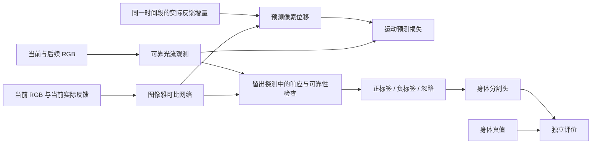

# 机械臂身体感知：讨论总结与第一版模型方案

整理日期：2026-10-24。

本文记录已确认的研究目标、现有仿真平台的能力，以及讨论形成的第一版学习方案。**目前已有 MuJoCo 试验台，尚未实现连续训练数据管线、PyTorch 身体感知模型或训练验证结果。** 下文中的网络、损失、伪标签和验收设计均为拟议方案，不代表已经实现或证明有效。

相关约定见 [研究目标与边界](research-scope.md)、[Seeed SO-ARM 资料索引](seeed_soarm/README.md)及[摄像头位置与模型输入](seeed_soarm/02-camera-and-model-inputs.md)。

## 1. 已确认的目标

最终成果是一个结合摄像头与身体内部反馈进行自我感知的模型。当前先回答“画面中哪些可见部分属于自己的活动身体”，随后研究不同关节的影响范围、身体运动预测和可复用的内部表示。仿真展示和纯图像运动检测都不是最终成果。

- 外部感知先使用机械臂外部固定摄像头的单路 RGB；双目、深度和可动云台后置。
- 内部感知先使用真实可读取的舵机位置反馈。动作指令与反馈分别记录：目标位置不是实际到达的位置。
- 模型可利用动作记录、反馈历史和时间关系，但不能直接获得机械臂的 CAD、连杆拓扑、部件身份或身体标注。
- 始终静止的底座按环境处理；活动连杆和夹爪暂时停止，仍应属于身体。
- 先实现身体感知，不开展抓取。稳定随动的工具是否纳入身体是后续问题。
- 动作相关不等于身体归属；某次动作没有带来变化，也不等于该区域是环境。影子和显露背景是已知干扰，但第一版暂不重点解决影子，应保留这一局限。
- 人工身体标注、仿真部件 ID、身体掩膜和理想几何仅用于独立评价，不进入身体发现的训练输入或伪标签生成过程。

“没有预先提供身体结构”不等于完全没有先验。第一版仍依赖固定相机、局部小位移近似、时间对齐、可跟踪的视觉表面以及足够的关节激励等通用假设。这些假设需要明示并通过实验检查。

## 2. 当前已经有什么

现有 MuJoCo 平台提供通用机械臂、夹爪、固定 RGB 摄像头、动作控制、自动探索、暂停、光照调整和观测快照。快照包含图像、动作目标、仿真状态，以及单独保存的评价掩膜和理想深度。具体操作见[项目说明](../README.md)。

当前界面中的“实测”来自 MuJoCo 状态，不是真实舵机读数；编码器误差、总线延迟、漏读和真实摄像头噪声尚未模拟。当前也没有连续数据集录制、光流处理、模型训练或真实硬件接入。

| 项目 | 当前通用仿真 | 目标 SO-ARM100/101 |
|---|---|---|
| 控制通道 | 六个手臂关节加夹爪，共七个 | 五个手臂关节加夹爪，共六个 |
| 夹爪机构 | 对向滑动双指演示结构 | 需按确认的实际型号对齐 |
| 位置反馈 | 仿真 `qpos`，含两根手指的关节坐标 | 实际舵机可读位置及其校准、单位 |
| 视觉 | 单路固定 640×480 RGB | 相机型号与最终布置待确认 |

因此，不能把现有仿真直接称为 SO-ARM，也不能把七个动作通道或底层全部 `qpos` 不加转换地塞入六通道模型。采集接口必须明确每个控制通道对应的实际反馈、顺序、单位和夹爪定义。未实际采集的电流、负载、温度等量，不预先当作可用传感器输入。硬件出处见 [Seeed 官方资料摘记](seeed_soarm/01-official-notes.md)。

## 3. 第一版方案的核心

拟议路线是：**实际反馈与视觉运动 → 学习每个像素的关节响应 → 经独立探测验证的高置信伪标签 → 身体分割模型。**

这里的运动学习服务于身体发现，并不把“预测成功”直接当作“理解了完整身体结构”。先建立一条可检查的监督链，再训练分割头。

### 3.1 网络输入与输出

以目标 SO-ARM 的六个反馈通道为例，令当前图像为 $I_t$，当前实际位置为 $q_t\in\mathbb{R}^6$。拟用小型 U-Net 提取图像特征，将位置反馈经 MLP 编码后融合，输出每个像素 $x$ 的矩阵：

$$
J_\theta(I_t,q_t;x)\in\mathbb{R}^{2\times6}.
$$

网络总共输出 12 个通道，表示各反馈通道发生小变化时，该像素所对应可见表面的二维运动响应。它不是预先计算的机械臂几何雅可比，而是从视觉和实际反馈中学习的局部映射。若仍在当前七通道仿真上试验，输出应为 14 通道，并明确那只是通用仿真实验。

对同步区间 $[t,t+\Delta t]$，从实际读数得到：

$$
\Delta q_t=q_{t+\Delta t}-q_t,\qquad
\hat f_t(x)=J_\theta(I_t,q_t;x)\Delta q_t.
$$

$\hat f_t$ 是这一时间区间内的像素位移；监督光流必须使用同一时间区间和同一源图像坐标。位移与速度的单位不能混用。关节量纲、归一化方式和夹爪位置定义也应固定。

**网络生成 $J$ 时只看当前图像和当前反馈。** 后续图像只用于计算监督光流，实际反馈增量只在网络输出后参与乘法，不输入生成 $J$ 的网络。第一版不必加入 GRU，也不让视觉短历史先把下一步运动直接告诉预测器。

动作指令和短历史仍应保存，用于实验组织、同步检查和后续扩展；这一最小教师模型先只用实测位移解释已经发生的视觉变化。它不能被描述为“仅凭动作指令预知未来实际运动”：若要在动作发生前预测，还需要另行建模指令到实际反馈的关系。

### 3.2 监督来自哪里

由 $I_t$ 和 $I_{t+\Delta t}$ 计算光流观测 $\tilde f_t$，再用前后向一致性、有效视野及遮挡检查等方式剔除不可靠区域。光流不是身体标签，只是从图像中得到的位移观测，也可能有误差。

可将 RAFT 作为候选光流工具；其任务是估计图像间运动，而不是识别身体。若使用预训练权重，应记录来源并承认引入了通用视觉运动先验，不能宣称整条系统完全从零训练。是否采用它及其计算成本，需在数据管线实现后评估。[RAFT 论文](https://arxiv.org/abs/2003.12039)

运动学习可采用带可靠性权重的稳健误差：

$$
\mathcal L_{\rm motion}=
\frac{\sum_{t,x}w_t(x)\,\rho\!\left(\hat f_t(x)-\tilde f_t(x)\right)}{\sum_{t,x}w_t(x)+\epsilon}.
$$

这里的 $w_t$ 来自独立的观测有效性检查和固定采样规则，不能由待学习的身体掩膜任意控制。否则网络把全部像素判成背景，就能逃避预测损失。运动区域与背景区域需要适当平衡，避免大量零运动背景使“全预测为零”看起来具有很低的平均误差。

### 3.3 数据要怎样采

在多个起始姿态下，先进行单通道、小幅、双向探测，再加入适量组合动作。每段尽量从静止开始，随机选择方向和探测通道；记录图像采样、指令发送和反馈读取时间。是否同步应以实际时间与延迟检查为准，不能因为写在同一条记录里就视为完全同步。

同一或相近起始姿态应覆盖多个独立反馈方向。一次观测对每个像素只提供二维位移，却要估计 12 个系数；若一直只动同一关节，其余方向就是欠定的。必须检查实际反馈增量矩阵的秩或条件数，不能仅靠增加同一路径的帧数解决问题。局部近似还要求控制运动幅度，并检查幅度增大时的预测误差。

训练、验证和测试按完整轨迹、探测批次或起始姿态分组。相邻帧不能随机分到不同集合，以免近乎相同的画面和动作同时出现在训练与测试中。身体真值始终放在评价通道，训练加载器使用输入白名单。

### 3.4 怎样得到非循环的伪标签

不能简单地把“网络预测像身体”当成标签，再用这些标签证明网络识别了身体。伪标签应同时依赖实际观测与未参与该次拟合的探测验证：

1. 先在一组轨迹上学习 $J$，在留出的探测轨迹上检查实际位移与预测是否相符。可在训练数据内部交叉拟合产生伪标签，最终测试集仍保持独立。
2. 只有在确实观察到运动、激励足够、多个探测下预测可靠且响应稳定的区域，生成高置信身体候选正标签。
3. 对充分激励后仍稳定无响应、且观测可靠的区域，谨慎生成背景候选负标签；不能因为某一帧没动就判背景。
4. 对遮挡、无纹理、跟踪失败、激励不足或结论冲突的区域使用“忽略”，不强行填成前景或背景。

可辅助比较正确反馈增量与置换反馈增量的预测误差。置换应在相近姿态、时长和探测幅度内进行，只改变增量对应关系；任意打乱全部状态会制造不合理样本。正确反馈除了优于置换，还应优于零运动基线且具有足够低的实际误差。这个比较支持运动关联，不能单独证明身体归属。

不能只按 $\|J\|$ 大小生成标签：欠定方向也可能出现任意大值。应结合激励充分性、留出误差和多次响应稳定性，并按各通道有实际意义的探测幅度比较响应。阈值先依据观测噪声与重复探测的一致性设置，不用身体真值制造训练标签。

### 3.5 从候选区域到分割模型

在教师模型和伪标签经过检查后，冻结第一版伪标签，为图像编码器增加单通道身体概率头，继续融合当前实际反馈。对高置信正、负标签计算分割损失，不确定像素不计入该损失。第一版先采用这一简单结构；短历史、跨帧特征和时序记忆待停顿或遮挡实验暴露具体问题后再增加。

部署时输入当前 RGB 和实际反馈，输出可见活动身体的概率图；无需未来图像或未来实际反馈。训练阶段的动作经验已体现在网络参数中。概率图可以再阈值化显示，但应同时保留置信度和不确定区域，不能把稀疏可靠种子的扩展结果自动当成完整身体真值。

## 4. 必须单独检查的边界与退化解

**潜在运动响应不等于当次运动。** 当机械臂停止时，$\Delta q=0$，因此当次预测光流为零；这并不要求 $J=0$。模型应保留“这个可见部分在关节变化时会响应”的表示，再据此识别停止中的身体。

同样，$\Delta q=0$ 时任何 $J$ 都能得到零预测，因此静止样本本身无法约束 $J$。它们可帮助测量视觉噪声和相机稳定性；背景响应为零的证据，必须来自其他通道实际受到充分激励时，该区域仍保持稳定。停顿中的身体保留需要专门测试，不能只凭上述公式保证。

| 风险 | 第一版的检查方式 |
|---|---|
| 全背景或全零预测 | 不让身体掩膜门控运动损失；单独报告运动区域误差，与零运动基线比较 |
| 全前景或任意大响应 | 使用充分激励下的背景证据，检查未激励方向、留出预测与正负标签比例 |
| 只用反馈记住固定机位下的姿态 | 设置去掉 RGB 的基线；在相同关节状态、不同遮挡画面下检查输出是否反映可见区域变化 |
| 视觉历史替代反馈 | 最小教师只看动作前的当前图像；从静止开始随机探测，并做反馈置换检查 |
| 伪标签自我强化 | 留出探测或交叉拟合验证，固定初版标签，不确定区域忽略，独立真值只用于评价 |
| 活动部件一停止就消失 | 单独评价停止片段，区分响应表示与当次光流 |
| 运动边界或无纹理区域缺失 | 报告伪标签覆盖率及分割误差，不能仅挑可靠点展示 |

在固定相机下，关节状态本身确实可能预测很多身体位置；反馈基线表现好并不荒谬。但若 RGB 分支没有在遮挡或可见性变化中带来可测量的作用，就不能宣称已经证明了视觉与内部反馈的融合价值。

影子在第一版暂不作为重点，不等于已经排除。它也可能随动作稳定变化并被准确预测；低预测误差和动作相关性都不是充分的身体判据。第一版结果必须注明实验光照条件和这一限制。

## 5. 与相关研究的关系

[DIJE 原始论文](https://arxiv.org/abs/2507.00446)研究从光流和关节反馈估计稠密图像雅可比，并利用估计结果进行自体识别；其具体估计器采用简化 Kalman Filter，而不是本文拟议的 U-Net。它为“视觉位移与关节变化的局部映射可用于身体发现”提供了直接相关的研究参考。[论文全文](https://arxiv.org/html/2507.00446v1)

本文的神经网络参数化、伪标签流程及 SO-ARM 实验设计是本项目待验证的方案，不能把 DIJE 的实验结论直接移作本项目结果，也不能把采用类似表示当成创新性已经成立。RAFT 在此仅是候选光流观测工具，两篇论文都不替代本项目的数据质量和独立评价。

## 6. 下一步与验收

以下是建议的实施顺序，尚未执行。具体数值门槛应在检查采样噪声、有效光流覆盖率和基线表现后确定；不预先承诺识别精度或训练时长。

| 顺序 | 交付内容 | 验收要点 |
|---|---|---|
| 1 | 确认 SO-ARM 版本、相机和六通道反馈约定；对齐仿真或明确通用试验范围 | 通道、单位、夹爪定义明确；指令与实测分开 |
| 2 | 连续序列采集、时间对齐和按轨迹划分的数据集 | 能复现动作区间；记录丢帧、延迟及真实反馈增量；评价真值未进入训练 |
| 3 | 可靠光流与运动基线 | 可查看光流、有效性掩膜、噪声分布和运动区域覆盖率 |
| 4 | PyTorch 图像雅可比网络及训练程序 | 留出轨迹上优于零运动基线；各通道有足够激励；正确反馈优于合理置换 |
| 5 | 高置信伪标签生成与分割头 | 同时报告正负标签精度、覆盖率和忽略比例；输出概率图并检查全前景／全背景退化 |
| 6 | 独立身体感知评价 | 用仅供评价的身体掩膜报告 IoU、精确率和召回率；分别报告运动、停顿、未见姿态及遮挡条件 |
| 7 | 视觉与反馈的消融比较 | 比较完整模型、去掉视觉的模型及去掉反馈的相应基线，明确各输入实际贡献 |

阶段成果首先应证明：模型在新的探测轨迹和姿态下，能从图像与实际反馈中得到有依据的身体候选，并在停止时保留可见活动部件。完整身体覆盖、真实硬件泛化、复杂影子、长期身体表示与工具纳入仍是后续需要独立验证的问题。
