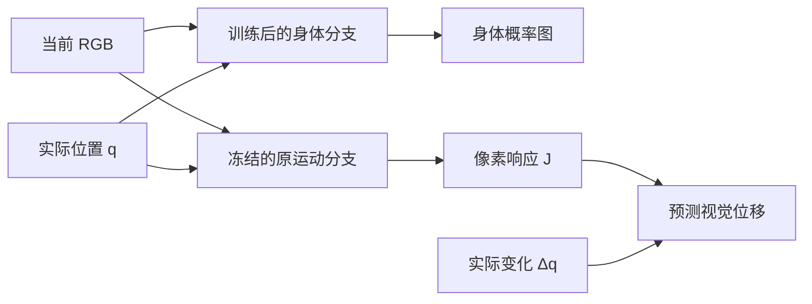

# V4：身体边界细化与运动响应保留

日期：2026-10-24。V4 已完成训练及独立测试。在新采集的同一批 32 个姿态上，身体分割 IoU 从 V3 的 **53.58% 提高到 70.31%**，运动后保持姿态的 IoU 从 **54.54% 提高到 70.67%**。32 个初始姿态全部改善，平均增加 **16.74 个百分点**。

本轮没有增加身体真值训练、CAD、部件身份或指定机器人颜色。改进来自更完整的图像弱标签，以及将身体分割和运动响应分开保存。当前关节位置反馈对分割的影响仍很小，本轮没有解决这一融合问题。

## 1. 问题定位

首先在上一轮已使用的 seed 20261026 上诊断，不把这批数据继续称为本轮独立测试。

原部分标签只将整图约 1.05% 标为动作支持的身体点，身体周围有宽阔的未知区域。分割 BCE 忽略未知像素，模型在这圈区域内画出粗轮廓也不会受到直接约束。RGB、标签与概率图的并列检查复现了这个现象。

另一个问题是共用特征被改写。原运动阶段检查点在这批数据上的运动/静止/整图 EPE 分别为 **0.7451 / 0.0576 / 0.0830** 像素；经过 V3 分割训练后变为 **0.8771 / 0.3210 / 0.3415**。只保留 0.1 倍运动损失，仍不足以维持原运动响应。

这些诊断分别保存在本地 `outputs/perception/optimization-diagnosis.png`、`optimization-diagnosis.json`。

## 2. 改了什么

### 2.1 从动作种子沿图像边缘补全弱标签

新增 `perception/refine.py`。输入仅为当前 RGB 和原来的动作/静态背景种子：1 表示正种子、0 表示负种子、-1 表示未知。逐图像使用 GrabCut，根据该图像中正负种子的颜色分布及相邻像素关系，推断原先未知区域。没有固定机器人颜色、区域位置、形状或部件先验。

已有正负种子作为硬约束保留；正或负种子少于五个像素时返回原标签，不自行产生身体。OpenCV 随机种子固定，每图五轮。原始光流种子保存在 `base_labels`，加上背景证据后的种子保存在 `seed_labels`，细化结果在 `labels`。是否细化及细化代码内容参与缓存指纹。

这是弱标签补全，不能将推断出的像素冒充动作直接验证的像素。默认旧路径不变，训练时用 `--refine-labels` 显式启用。背景参考仍只从训练 RGB 拟合，测试仅应用冻结参考。

在开发集上，原动作正种子的身体召回约为 38.5%，细化标签达到 81.2%，正标签精确率分别为 91.4% 和 91.1%。这些数值仅是评价，生成标签的函数不读取真值。

### 2.2 组合独立的身体与运动网络

新增 `perception/compose.py`，并给 `BodyPerception` 增加兼容旧检查点的 `separate_motion` 选项。



身体分支从原 20 轮运动权重初始化，使用细化标签训练 30 轮分割，保留原来的辅助运动损失。训练结束后，将它的身体输出与原运动检查点的 J 输出组合成一个新检查点。组合阶段没有优化、阈值选择或真值输入。

两套权重相互独立，冻结的运动分支不接收身体训练梯度。组合前严格检查模型配置和反馈归一化/单位是否相同，并保存两份源权重的 SHA-256。回归测试验证组合后的身体 logits 与身体源完全相同，J 与运动源完全相同。

这是一套组合模型，参数从 127,423 增至 **254,846**，权重约 **1.06 MB**。它通过保留运动源恢复原有能力，不代表分割训练本身获得了更好的运动学习。推理只需要 RGB 和实际 q，不运行 GrabCut，也不读取背景参考。

## 3. 训练与独立测试

训练仍用 seed 20261024 的 64 个训练姿态和 16 个验证姿态。权重只按观测验证损失选取。CPU 四线程、batch size 4，细化缓存准备与 30 轮训练共约 **244 秒**。原运动分支直接复用，没有重复训练它。

开发集使用上一轮的 seed 20261026，仅用于检查预期问题是否减少。冻结 V4 后，新采集 **seed 20261027 的 32 个姿态组**，将 V3 和 V4 在这批相同图像、反馈、真值上比较。本轮最终测试后没有继续调规则或训练。

| 指标，逐姿态平均 | V3 | V4 |
|---|---:|---:|
| 初始姿态身体 IoU | 53.58% | **70.31%** |
| 初始姿态精确率 | 65.25% | **77.33%** |
| 初始姿态召回率 | 75.01% | **88.60%** |
| 运动后保持姿态 IoU | 54.54% | **70.67%** |
| 运动后保持姿态精确率 | 65.41% | **77.16%** |
| 运动后保持姿态召回率 | 76.69% | **89.41%** |

V4 初始姿态 IoU 最低 **68.07%**、中位 **70.31%**、最高 **72.72%**。配对初始姿态的增益范围为 **14.15～20.06 个百分点**，32/32 个姿态改善。对比图按 V4 的最低、中位和最高分选取三组相同观测，同时展示源图像与运动后保持图像。

视觉运动误差 EPE，单位为像素，越低越好：

| 方法 | 运动区域 | 静止区域 | 全部有效区域 |
|---|---:|---:|---:|
| V3 + 正确 Δq | 0.9316 | 0.3216 | 0.3442 |
| V4 + 正确 Δq | **0.8088** | **0.0595** | **0.0872** |
| V4 + 打乱配对的 Δq | 2.6558 | 0.0946 | 0.1893 |
| 全部预测不动 | 2.3494 | **0.0044** | 0.0911 |

V4 整图误差比 V3 降低约 74.7%。静止背景仍弱于零运动基线，因此没有解决所有背景响应；整图相对零运动基线的优势也很小。目标仍是 **RGB 估计光流**，不是仿真物理真值流。

连续 90 帧、15 fps 的演示使用相同于上一轮的确定轨迹：60 帧运动平均 IoU **70.35%**；30 帧保持中排除最初 0.3 秒稳定过程，余下 26 帧平均 **70.42%**。保持阶段平均旋转关节速度约 0.00073 rad/s。这是一条轨迹的展示，不作为另一个独立统计测试集。

## 4. 没有解决什么

固定 RGB 和实际 Δq，只扰动当前 q：

| 当前 q 输入 | 身体 IoU | 运动区域 EPE |
|---|---:|---:|
| 正确 q | 70.3142% | 0.8088 |
| 跨姿态打乱 q | 70.3170% | 0.8227 |
| 固定为归一化中心 | 70.2457% | 0.8141 |

打乱 q 只改变预测身体并集约 **1.14%** 的像素。身体分割仍主要利用视觉外观；不能把更高的 IoU 解释成已完成视觉与即时本体反馈的充分融合。这个推理扰动也不能替代重新训练的图像单模态对照。

最终细化标签的正标签精确率约 **90.99%**、覆盖整图约 2.21%。由于它给原未知像素都作了推断，已知标签覆盖率为 100%，但错误负标签仍包含 **3,917 个身体像素，占真实身体约 18.0%**。原有种子错误无法通过硬约束的细化自动纠正。这会限制靠近底座、弱运动表面及夹爪的恢复；模型也仍会产生粗轮廓。

其余边界延续上一轮：固定相机与外观、关闭投影阴影、理想无噪声反馈、有限姿态范围、通用七通道机构，无 SO-ARM 真机、未知工具、抓取或长期记忆验证。组合模型还增加了推理计算量。本轮没有通过换评价口径或调整阈值扩大增益。

## 5. 交付位置与复现

本地生成文件均在 Git 忽略的 `outputs/perception/` 下：

| 文件 | 内容 |
|---|---|
| `run-v4/model.pt` | 最终组合权重 |
| `run-v4-body/` | 分割训练的源权重与逐轮日志 |
| `v4-final-report/comparison.html` | 新旧模型相同姿态对比，内嵌图像 |
| `v4-final-report/comparison.json` | 配对指标和权重哈希 |
| `v4-final-report/report.html`、`metrics.json` | 完整新模型结果 |
| `v4-final-report/motion-demo.gif`、`motion-demo.json` | 连续运动、保持与实际反馈 |
| `v4-final-report/feedback-ablation.json` | 当前 q 扰动诊断 |
| `v4-baseline-report/` | V3 在同一批新姿态上的结果 |

最终权重 SHA-256：

```text
80f828855bf48254e85841005a8cb9244f9463dc84c2ff86f68264c449867ec4
```

已有 V3 数据及运动检查点时，本次训练和组合命令：

```powershell
.\.venv\Scripts\python.exe -m perception.train --data outputs/perception/data-v1 --cache outputs/perception/new-v4-cache --reuse-cache outputs/perception/cache-v3 --output outputs/perception/new-v4-body --motion-epochs 0 --segmentation-epochs 30 --threads 4 --init-checkpoint outputs/perception/run-v1/motion-normalized.pt --refine-labels
.\.venv\Scripts\python.exe -m perception.compose --body-checkpoint outputs/perception/new-v4-body/model.pt --motion-checkpoint outputs/perception/run-v1/motion-normalized.pt --output outputs/perception/new-v4/model.pt
```

没有已有运动检查点时，先按[第一版实验](first-model-experiment.md)采集训练数据并完成 20 轮运动训练，使用该轮保存的 `motion.pt`。模型归一化必须一致，不可用改了单位或通道的检查点替代。

新实验的一条命令入口也已支持这两个选项。它在同一次训练中执行两阶段，分割阶段的样本打乱随机流与本次单独重启分割阶段略有不同，因此不要将新输出视为现有检查点的逐字节复刻：

```powershell
.\.venv\Scripts\python.exe -m perception.run --output outputs/perception/new-optimized-run --train 64 --val 16 --test 16 --motion-epochs 20 --segmentation-epochs 30 --threads 4 --refine-labels --preserve-motion
```

结果权重在 `composed/model.pt`，报告仍在 `report/`。该入口已经用 2 个训练、1 个验证和 1 个测试姿态，各训练一轮，验证完整流程；小样本指标不用于本轮结论。

重做相同最终评价（选择新输出目录保护已有报告）：

```powershell
.\.venv\Scripts\python.exe -m perception.evaluate --data outputs/perception/data-v4-final --checkpoint outputs/perception/run-v4/model.pt --cache outputs/perception/cache-v4-final --output outputs/perception/new-v4-report --threads 4
.\.venv\Scripts\python.exe -m perception.evaluate --data outputs/perception/data-v4-final --checkpoint outputs/perception/run-v3/model.pt --cache outputs/perception/cache-v4-final-base --output outputs/perception/new-v3-report --threads 4
.\.venv\Scripts\python.exe -m perception.compare --baseline-metrics outputs/perception/new-v3-report/metrics.json --candidate-metrics outputs/perception/new-v4-report/metrics.json --output outputs/perception/new-v4-report
.\.venv\Scripts\python.exe -m perception.demo --checkpoint outputs/perception/run-v4/model.pt --output outputs/perception/new-v4-report/motion-demo.gif
```

最终数据的采集种子为 20261027，使用 `collect --train 0 --val 0 --test 32`。测试缓存必须显式传入冻结的训练 `background-reference.npz`；原种子缓存用 `refine_labels=False`，细化缓存用 `refine_labels=True`，后者可复用前者光流。禁止在最终测试图像上重新拟合背景。

已通过 **25 项单元测试**，包括新增的四项图像边界细化测试及三项组合/单位一致性测试；保留了原有光流、反馈配对、未知标签梯度和真值隔离测试。
