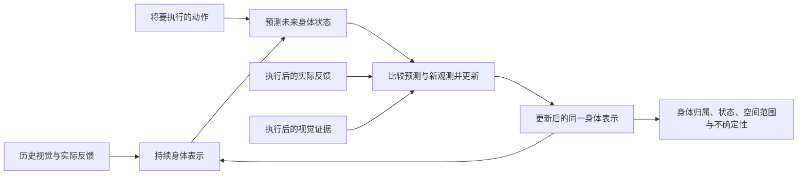

# 机械臂感知模型：课题定义、核心问题与验收框架

更新：2026-10-25（Asia/Shanghai）。本文件汇总 E7 后讨论中确认的研究目标，实验进展更新至 E13，是后续模型、实验和报告的共同依据。具体方法和结果以各阶段冻结记录为准；目标定义不等于所有能力已经完成。

## 1. 我们真正要做什么

**让模型通过自身运动，将动作命令、身体实际反馈和视觉证据联系起来，发现哪些部分属于自己的活动身体，估计并预测它的空间状态，形成对机械臂这一物理实体的持续表示，并在证据不足或冲突时表达不确定性、利用后续证据修正认识。**

三个核心问题分别是“发现我”“预测我”“表示我这个实体”。可靠感知贯穿三者；后续每项工作都应说明它在解决哪个问题、改善哪项可靠性，以及是否服务于同一个身体表示。

这里的“感知”是可检验的计算能力，不推论主观意识。第一阶段面向当前仿真机械臂及明确的观测范围，逐步扩展；不把抓取成功、完整三维网格或全部物理参数辨识作为身体感知的先决条件。

## 2. 三个核心问题

| 核心问题 | 模型需要回答什么 | 应交付的能力 | 怎样检验 |
|---|---|---|---|
| **发现我：通过自身运动区分本我与非我** | 哪些可见部分属于自己的活动机械臂？哪些是环境？哪些证据还不足？ | 利用动作、实际反馈和视觉响应建立身体归属；允许未知区域；活动部件停止时仍保留归属 | 在新动作、不同关节激励和停止条件下评价身体纯度、覆盖率、环境误认及未知比例；用正确、打乱和恒定反馈，以及正确和错配动作做对照 |
| **预测我：估计当前状态，并提前预测动作后果** | 身体现在在哪里、是什么关节构型？执行给定动作后会怎样变化？ | 当前身体状态估计、执行前的未来状态预测、观测后的状态更新；先验证位置和构型，再验证明确指定部位的朝向 | 预测在动作执行前保存；比较保持状态、命令目标即状态、无动作和错误动作对照；评价不同预测时距的误差，以及同状态不同动作的结果差 |
| **表示我这个实体：建立持续的身体表示** | 身体占据哪些空间？有哪些可区分的部分？这些部分怎样共同变化？停止或暂时不可见时，是否仍表示同一个身体？ | 可随状态变化的身体范围、从观测学习的部分关系和跨时间状态；标记已观测、模型推断和未知的区域 | 在共同评价范围内检查空间覆盖、虚假占据、形状或表面误差、关系一致性，以及停止／遮挡／重现后的状态连续性 |

“动作相关”只是身体归属的证据之一。影子、露出的背景也可能随动作改变；没有被选中的点也不能自动判为环境。需要多个动作、实际反馈和视觉后果共同排除这些解释。

“位置”和“姿态”必须区分：当前稀疏点坐标与关节构型已有预测证据，尚未直接验证各连杆或末端完整六自由度位姿。后续若宣称朝向能力，必须指定对象、坐标系和角度误差指标。

实体表示可以从粗略表面、空间范围或占据估计开始，不要求一开始得到完整网格。未观察到的区域应保留不确定性；有限的可见点无法单独证明完整体积已经学会。

## 3. 三个问题必须连接在同一个身体表示上

预期的信息流程如下，其中身体表示的具体结构仍是研究选择：

身体归属决定哪些观测可用于更新身体；状态与动作模型预测这些身体部分如何变化；新视觉和反馈检验预测，并修正状态、归属或形态。发现与预测可以相互帮助，遮挡恢复是检验这一循环的一种条件。

“共同表示”不要求第一版是一个端到端大网络。可以使用可解释状态、小型学习模块和显式更新机制，但各模块必须作用于同一身体对象，输出可比较的身体量。人工定义的状态、跟踪规则和融合门限需明示，不能把这些统称为模型自主学会。

各路证据还需记录来源。特别是视觉匹配若使用动作先验初始化，其误差可能与动作预测相关，不能按完全独立的证据重复增加可信度。

## 4. 可靠感知：贯穿三个核心问题的验收要求

| 要求 | 合格表现 | 需要报告的证据 |
|---|---|---|
| **空间与结构一致** | 身体范围、部分关系和预测运动相容；提高点纯度时仍保留合理覆盖 | 误差、覆盖与虚假占据同时报告；在共同评价对象上比较；说明未观测区域和结构先验 |
| **时间连续** | 运动、停止、短时遮挡和重现期间保持身体状态；重现后可纠正累计误差 | 按遮挡时长报告漂移、恢复时间与错误更新；区分直接观测和递推估计；精确旧特征点恢复只作为一项诊断 |
| **知道何时不确定，并能纠错** | 缺失或冲突时降低自信；有可辨识的新证据时修正状态；无法确定故障来源时保留多种解释 | 正常／故障分条件误差，错误修正率，误差与不确定性的对应，置信区间覆盖或风险—覆盖关系；同时展示失败条件 |
| **在明确范围内泛化并可复现** | 新轨迹、新动作或姿态上仍有效；收益在多个种子重现，正常条件的退化可控 | 按轨迹隔离训练、开发与最终测试；冻结后新数据；逐种子结果、适用范围、配对基线及事先规定的容差 |

权重不等于可靠性概率。E7 的融合权重说明模型采用了多少某路信息，尚不能直接解释为“这路信息有多少概率正确”。同样，三路信息相互冲突时，现有观测可能不足以唯一确定谁错了；可靠模型应允许“不知道”。

主动探测是进一步解决不确定性的方法：在允许的动作范围内，选择能区分竞争解释的动作，再用真实结果检验。它需要与随机／预设探测比较信息收益、状态误差和运动代价。相机或身体变化后的适应属于后续能力扩展，应单独设计实验。

## 5. 现有证据与缺口

以下结果来自不同实验协议，不能把各阶段的绝对误差直接横向排名。

| 研究目标 | 目前已有证据 | 仍不能据此宣称 |
|---|---|---|
| 自身运动发现身体 | E1 使用正确反馈选出 46 个候选，打乱或恒定反馈均为 0，支持视觉响应与实际反馈有关；E4 分割辅助提高候选纯度，但覆盖有所下降 | 已可靠发现整个身体；所有动作相关区域都属于身体；E7 重新学会了身体发现 |
| 当前状态与动作预测 | E6 三个新种子的提前预测身体误差 10.53 mm，无动作对照 20.07 mm；36 组同状态不同动作的结果差预测误差 2.22 mm | 已预测完整连杆位姿；已泛化到任意姿态、相机或真实机械臂 |
| 实体表示与连续性 | E2—E7 使用反馈／状态到稀疏三维点的身体模型；E5 有显式视觉记忆，E6 将动作、反馈和视觉接到共同状态 | 已学得完整空间范围、体积、部分关系或可靠的持续身份；当前 41 个候选中也并非全部都是真身体点 |
| 视觉纠错 | E5 的偏差反馈条件下，视觉辅助使身体 RMSE 从 24.12 降至 10.12 mm；正常条件从 9.74 变为 10.23 mm | 视觉更新总是有益；原点恢复 10/81 已足以证明持续身份可靠 |
| 学习信息可信度 | E7 正常 10.59 mm，仅反馈 10.27 mm；偏差反馈下学习融合 14.73 mm，仅反馈 36.83 mm；反馈权重约从 71% 降至 5% | 三路可信度已经通用可用；偏差反馈下仍差于仅动作 13.58 mm，错误图像还会误导权重，学习融合误差 12.83 mm |
| 后续可靠更新优化 | E8B 在三个新种子、八种条件中七种优于同批 E7；错误图像改善 12.94%、反馈偏差改善 13.32%，正常保护逐种子通过；90% 状态区间总体覆盖 90.11% | 共同故障已解决；反馈＋图像受损误差由 14.823 升至 15.781 mm；反馈缺失区间覆盖仅 77.78%，完整实体范围也未增加 |
| 部分实体表面范围 | E9B 从双目、运动和反馈注册 434 个片段，连接同一个 E8B 状态；三个新种子上，左相机清除屏后的身体表面覆盖 10.44%→32.19%，离体点 0.060%→0.123%，主要保护通过 | 完整体积、部件关系或持续点身份；等点数多参考仅 +2.00 个百分点，未达预设 3；共同故障仍退化，错误图像下匹配支持也会失真 |
| 冲突、未知与恢复 | E10 冻结旧模型，三个新种子、七条件；五条件每个6/6次恢复，协同回放5/6；几何审计宏F1为0.871，正常误报0.37% | 已可靠识别错误来源；协同回放23次唯一离群判断有22次错误排除更好候选，几何比关节只高0.025未达0.05目标；完整模型四错误条件13.265mm仍差于仅动作11.699mm；新增未知是显式读出 |
| 相依证据、竞争候选与真实更新 | E11 同源观测去重，六候选与恢复提交；三个新种子十条件；协同回放确认1.15→0.90s，96次提交实际改变状态和后续预测 | 共同故障14.355→14.497mm，变差0.99%；107个不可辨识帧只有1帧同时覆盖两真状态；执行受阻、反馈健康仍98.058mm，仅反馈12.313mm；显式未知不等于正确候选或可靠感知 |
| 持续运动解释与反驳错误动作先验 | E12同批持续受阻105.764→11.767mm；配对恢复6/6；两真实状态包络覆盖29.36% | 完整概率依赖建模、任意故障识别、完整实体身份或实机泛化；运动假设与门限仍为显式设计 |
| 视觉选择与分支误差范围 | E13两受阻交叉条件改善85.1%/85.1%，两构型包络覆盖82.9% | 单一相机来源歧义、无视觉受阻、概率校准、任意受阻起点与实机泛化 |
| 主动探索 | E4 五个采集种子的平均误差：主动 11.57 mm、随机 11.94 mm，4/5 种子更好 | 已有稳定优势；配对差的区间仍包含 0，且不能忽略可见覆盖和运动代价 |

E7 的正常条件 +0.5 mm 是该次协议事先设定的退化容差，不是整个课题的通用精度标准，也不是已经证明的统计非劣性。其三个最终测试种子支持的是当前有限条件下的结果。

当前最准确的定位是：**已经有动作—反馈—视觉共同更新身体状态的原型、局部预测和纠错证据，以及接到同一状态的部分表面图谱；完整实体表示和可靠感知仍是正在研究的目标。** E9 最近表面距离与 E8 固定对应点 RMSE 的对象不同，不能直接比较。

E10 对冲突生命周期的独立验证进一步表明：观测恢复后的收敛与可靠识别故障来源是不同能力。两路受损观测彼此一致会误导显式离群诊断；原模型的置信区间在平滑新轨迹中较保守，不能把覆盖接近100%解读成精确概率校准。

E11 已实现来源去重、竞争候选及后续状态提交，但没有完成可靠解释选择。八个恢复条件各6/6，同批E8B也各6/6；正常未知率20.37%，配对虽100%未知却几乎没有同时保留两真状态。执行受阻时正确反馈已在候选里，主状态仍跟随错误动作先验。这说明下一步需让各解释维护自己的状态递推与观测预测，并允许可信反证否决动作路径；不能仅添加快照、扩大包络或要求动作也同意才纠错。当前候选和门限为显式推断，没有新的神经训练或完整联合概率模型。详见[E11结果](body-hypotheses-e11-summary.md)。

E12 在同批三个新种子、十二条件中，健康持续受阻30–149帧固定锚点误差由冻结E11的105.764降至11.767mm，改善88.87%；配对新证据恢复6/6，6/6在1秒内确认。109个不可辨识分歧帧未知率100.00%，包络同时覆盖两真实状态29.36%；正常未知率1.30%。共同故障宏误差相对同批E11变化-14.29%（正为变差）。 未通过的预设验收：保留真实竞争状态与正常可用性。 本轮优化显式运动解释与状态更新，旧网络未重训、干扰物固定；停止假设和门限仍为人工设计，不是完整概率推断或完整身体身份。受阻持续时间与旧E11实验不同，收益只能由本轮同批对照判断。135项回归通过。 见[E12方法与完整结果](body-branches-e12-summary.md)。

E13 在三个新测试种子、十三条件中，受阻＋反馈偏差故障窗口误差从同增强观测E12的75.252降至11.216mm（改善85.10%）；受阻＋反馈缺失故障窗口误差从同增强观测E12的75.252降至11.216mm（改善85.10%）。111个不可辨识分歧帧，未知100.00%，两实际构型同时覆盖82.88%（同批E12旧余量20.72%）；正常未知1.48%。预设验收未通过：候选覆盖及宽度。本轮为显式视觉选择与分支经验误差校准，网络未重训；搜索起点2→4，固定干扰物。无视觉受阻、完整身体范围及实机泛化仍未解决。148项回归通过。 见[E13完整报告](body-evidence-e13-summary.md)。

## 6. 输入、先验与实验边界

- 学习可使用动作命令、时间、实际传感反馈和 RGB 历史。命令目标与实际到达状态分开保存，未来观测不能进入提前预测。
- 身体发现不直接接收 CAD、预定义连杆拓扑、部件身份、人工身体标签或仿真身体几何；仿真器本身当然包含机械结构，但不得通过学习接口泄漏。
- 身体身份、掩膜、深度和几何真值单独用于评价。若开发阶段曾使用评价真值诊断或选择方法，需如实记录，并用新的最终测试隔离。
- 当前公制三维依赖已标定双目 RGB，基线 6 cm；已知控制／反馈通道、时间对齐及模型适用的动作范围均属先验。不能据此宣称未知尺度单目感知已解决。
- E6/E7 使用干净初始状态；E7 使用合成反馈／图像故障和训练时的干净反馈教师监督可信度学习。这不同于完全无监督地从故障数据中自行发现可信度。
- E7 的视觉前端由独立动作递推提供匹配先验，后续不使用干净反馈，但并非与动作通道统计独立。硬性屏蔽缺失通道属于显式机制。
- 原有桌面干扰物保持固定，让机械臂自己运动、进入遮挡和再出现。新增遮挡装置或相机变化必须在具体协议中单独声明。
- 活动手臂及夹爪属于当前研究的身体；活动部件暂时停止仍是身体。始终固定的底座按此前约定作为环境处理，这是本实验的操作性范围。
- 当前是通用仿真机械臂。真实 SO-ARM100/101 的型号、通道结构和相机尚需确认及对齐，不能将仿真结果当作实机证据。
- 抓取、工具纳入、任意形态适应及精确质量／摩擦参数学习后置。它们可以扩展课题，但不应替代当前三个核心问题。

## 7. 接下来如何推进

### 第一阶段：统一定义、输出和验收

以本文作为研究入口。每个新实验开始前，写清目标问题、输出对象、训练输入、显式先验、强基线、最终测试和失败判据。延续同一个身体表示的主线，并保存各阶段预测和更新的依据。

第一阶段的结果接口至少能表达：身体／环境／未知的归属；当前身体状态；指定动作的未来预测；身体空间范围及未观测区域；各输出的观测来源和不确定性。它们是待实现和检验的输出契约，不是现有代码均已具备的功能。

### 第二阶段：补实体范围，并验证可靠更新

E9B 已验证从固定稀疏点扩展到部分表面图谱可行。接下来继续扩展未覆盖的表面，检验部分关系，并把当前匹配支持与真实可靠性分开评价；不能以填充包围框推断未知体积。严格注册减少了首轮离体错误，同时降低部分覆盖，需继续报告这种取舍。

同时沿用动作预测—反馈检查—视觉纠错的循环，重点诊断错误视觉、偏差反馈和共同受损条件。改进目标是降低状态错误、虚假身体范围和过度自信，而不仅是让融合权重看起来合理。

具体选择表面表示、占据表示或其他结构，应先做同预算对照再决定；不提前把某一种网络架构等同于课题目标。

### 第三阶段：用主动行动验证身体认识，再扩展适应性

围绕同一个身体表示选择能减少不确定性的动作，比较主动、随机、预设策略的误差、身体覆盖、信息收益与运动代价。先在固定干扰物的已知试验范围内验证，再分别研究观测变化、身体变化及真实硬件迁移。

这是一条研究优先级路线，具体实验方案和数值阈值需在最终测试前冻结。不会因某个子任务分数提高，就直接宣布三个核心问题已经完成。

## 8. 每轮实验共同遵守的验收规则

1. **明确主张。** 写明本轮检验身体发现、当前估计、提前预测、实体范围或哪项可靠性；说明预期失败会推翻什么主张。
2. **使用可比较的评价对象。** 同一身体参考集合或同一空间采样域；同时报告误差、覆盖、错误归属、不可用输出，不能只删除困难点降低 RMSE。
3. **保留有解释力的对照。** 按问题选择视觉、反馈、动作单路，固定与学习融合，保持状态，以及正确／错配动作和反馈；E7 的视觉前端有动作先验，不可称为纯视觉基线。
4. **按完整轨迹隔离数据。** 训练和开发用于学习及选择，冻结后才评价新最终测试。旧最终测试一旦转作训练，必须重命名其用途并使用新的最终测试。
5. **先定阈值，再看最终结果。** 在协议中指定空间／角度／时间误差目标、覆盖要求、正常退化容差、置信度评价和种子数；本文不虚构尚未确定的统一数值。
6. **分条件展示收益和失败。** 正常、停止、遮挡／重现、反馈受损、错误图像及共同受损分别报告；多种子不能只展示均值，也不能把单一条件改善解释为通用可靠性。
7. **保留复现证据。** 保存配置、输入权限、模型与数据哈希、动作前预测、逐帧更新、共同分母和失败例。代码测试通过与科学主张成立分别说明。

最终交付应包括可复现的数据与输入约定、共同身体表示模型、三类能力的预测／查询接口，以及含对照与失败的评价报告。演示页面用于理解结果，结论由这些证据支持。

## 9. 实验依据与历史资料

- [简要目标与边界](research-scope.md)；[早期讨论记录](discussion-summary.md)仅保留历史方案。
- [E1 身体发现](body-entity-model.md)、[E2 稀疏空间模型](entity-stereo-refinement.md)、[E3 主动探索](active-exploration.md)。
- [E4 共同表示与联合评价](body-cycle-e4.md)、[E5 记忆与状态纠错](body-recovery-e5.md)。
- [E6 动作—反馈—视觉实验](action-body-e6.md)及其[执行前协议](action-feedback-vision-validation.md)。
- [E7 信息可信度学习：方法、结果与失败](learned-trust-e7.md)。
- [E8 / E8B 两轮可靠更新优化总结](model-optimization-e8-summary.md)，及 [E8A](reliable-state-e8.md)、[E8B](reliable-state-e8b.md) 执行协议与过程。
- [E9 / E9B 身体表面范围总结](body-extent-e9-summary.md)，及 [E9A](body-extent-e9.md)、[E9B](body-extent-e9b.md) 执行前协议。
- [E10 冲突、未知与恢复结果](body-conflict-e10-summary.md)及[执行前协议](body-conflict-e10.md)。
- [E11 相依证据、竞争候选与后续纠错结果](body-hypotheses-e11-summary.md)及[执行前协议](body-hypotheses-e11.md)。
- [E12运动解释与反驳动作先验](body-branches-e12-summary.md)及[协议](body-branches-e12.md)。
- [E13视觉选择与误差校准](body-evidence-e13-summary.md)及[协议](body-evidence-e13.md)。
- [相关研究与开源笔记](research/2026-10-24-related-work.md)；[硬件资料与输入约定](seeed_soarm/README.md)。
