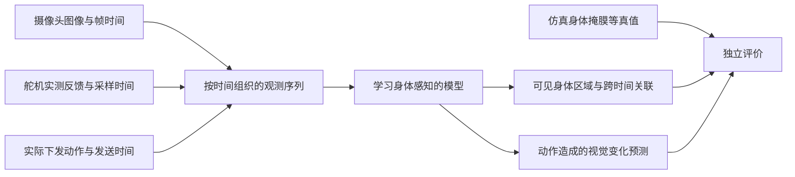

# 摄像头位置与身体感知模型输入

记录日期：2026-10-23。下述位置和实现状态记录当时的项目；模型输入方案是针对用户研究目标提出的约定。当时尚未实现训练管线。2026-10-24 已完成通用仿真原型的训练与评价，见[第一版模型实验](../first-model-experiment.md)；SO-ARM 硬件接入仍未完成。

2026-10-24 的讨论进一步确定了第一版候选路线：先学习图像与实际位置反馈对应的局部运动响应，再训练身体区域输出，详见 [讨论总结](../discussion-summary.md)。本文保留相机配置与采集约定；序列应完整记录，但首个运动响应网络可从当前图像和当前位置反馈起步。

## 当前仿真相机在哪里

场景文件：`sim/scene.xml`，相机名 `fixed`。

| 项目 | 当前设置 |
|---|---|
| 安装关系 | 固定在世界坐标系，机械臂外部，不随任何关节运动 |
| 位置 | `(1.05, -1.45, 1.08)` 米 |
| 参考 | 底座中心所在的地面附近为 `(0,0,0)`，Z 轴向上 |
| 水平距离 | 距底座中心约 1.79 米 |
| 高度 | 距地面 1.08 米 |
| 朝向 | 从斜前上方看向机械臂；相机局部 -Z 为观察方向 |
| 垂直视场角 | 46 度 |
| 输出 | 单路 640×480 RGB |

这些是当前通用场景的取景参数，并非 SO-ARM 官方安装尺寸。真实相机位置应根据镜头视场、机械臂尺寸和运动范围调整，不能机械复制这些距离。

## 本项目的相机布置建议

先用机械臂外部的固定支架，把主相机放在斜前上方或斜侧上方，让各活动关节、连杆及夹爪在主要探索姿态下尽可能完整入镜，并给运动范围留余量。优先避免上臂长期挡住前臂，以及末端经常出画。支架固定性要能避免机械臂动作带动整幅画面抖动。

当单视角遮挡确实妨碍判断时，再用第二个固定侧视角补充。腕部视角主要补充末端附近观察；云台运动会增加相机自身运动因素，仍按已有讨论后置。

这段是本项目建议。官方相机布置出处见 [官方摘记第 4 节](01-official-notes.md#4-官方相机布置)。

## 最终学习目标

最终成果应是一个能结合相机和身体内部反馈进行自我感知的模型。仿真平台用于提供探索经验、可控干扰和评价条件，不是最终成果。

## 建议的数据边界

| 类别 | 内容 | 约定 |
|---|---|---|
| 外部观测 | RGB 图像；以后确实接入时的测量深度 | 保存相机标识、帧时间、帧是否过期或缺失 |
| 身体反馈 | 六个 SO-ARM 控制通道的实际位置 | 区分编码器原始读数、校准后位置、单位；通道顺序固定 |
| 扩展反馈 | 实际读到的速度、电流、负载、电压、温度 | 确认型号、量纲、采样率后再启用，不假设默认已有 |
| 动作记录 | 实际下发的位置目标，必要时包含速度/加速度设置 | 与实际反馈分开；被限幅后的动作和原请求都可保留 |
| 对齐信息 | 动作发送时间、舵机读取时间、相机采样时间 | 不能因为存在同一条记录就声称完全同步 |
| 评价信息 | 身体掩膜、几何部件 ID、仿真理想几何与深度 | 不进入身体发现模型的输入白名单 |

最初可以用位置反馈和 RGB 建立可信的观测序列，然后增加其他有实际采集依据的反馈。额外通道是否提高身体感知效果需要实验，而不是预先保证。

学习器可知道控制通道编号及反馈，不能通过带有解剖语义的名称、CAD 拓扑或部件标签直接取得答案。工程元数据可以保留这些信息，但模型数据加载器应使用输入白名单，不把整个状态 JSON 原样输入。

## 当前仿真与目标硬件的差距

1. 当前是六个手臂旋转关节加夹爪，共七个动作通道；SO-ARM100/101 是五个手臂关节加夹爪，共六个。当前平台尚未替换为 SO-ARM 模型。
2. 当前夹爪是对向滑动的双指演示结构，不能假定等同于真实 SO-ARM 的夹爪机构；通道数量相同也不代表结构相同。
3. 界面所称“实测”目前来自 MuJoCo `qpos`，是理想仿真状态。尚未建模磁编码器量化、总线延迟、漏读、噪声和校准误差。
4. `qvel` 是仿真速度，不能自动当成真实舵机速度寄存器的测量值；MuJoCo 执行器力也不能直接作为 STS3215 电流或 Load。
5. 当前未模拟电流、温度、电压等反馈；未接入真实相机或舵机。
6. 现有快照中的理想深度和身体掩膜仅供评价；相机位姿等工程信息也不是本阶段默认给学习器的身体先验。
7. 快照能保存某一时刻，但学习动作与变化还需要连续序列、明确的动作时段、训练/测试划分和真正的模型。这些尚未实现。

本次仅整理位置和资料，未改动正在运行的场景或声称已完成传感器仿真。下一次实质改动应以已确认的 SO-ARM 版本和相机配置为依据。
